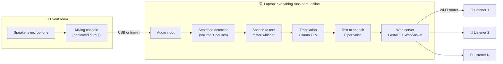
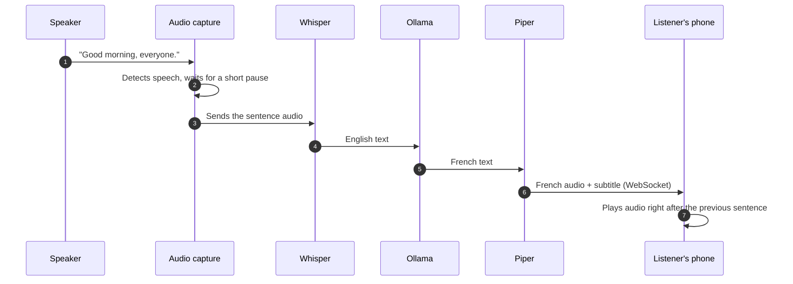
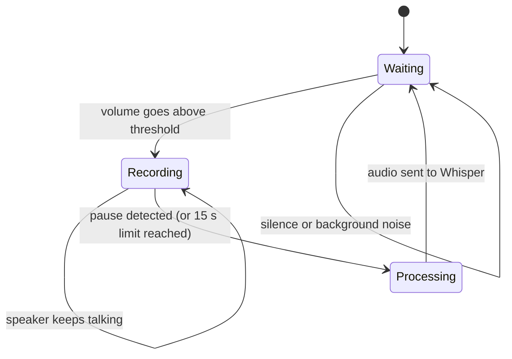
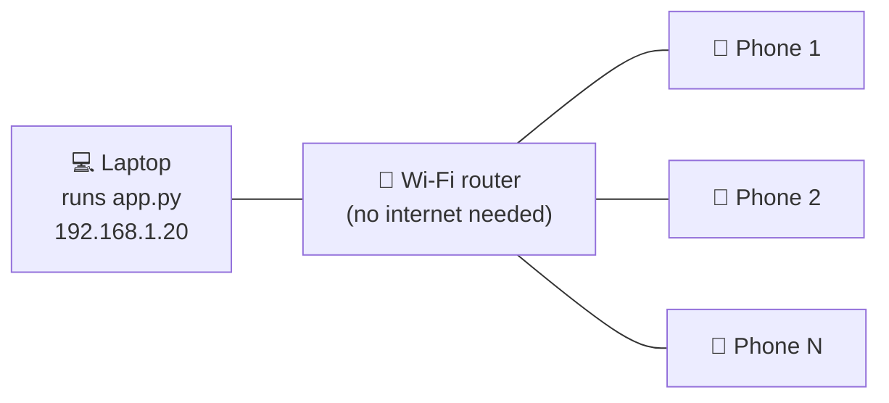

# 🎧 Live Translator

**Real-time speech translation broadcast. 100% local, 100% free, no cloud.**

A speaker talks into a microphone. Seconds later, listeners hear the translation in their own language through their phone and earphones. It runs on one ordinary Windows laptop, connected to a mixing console, and needs **no internet connection and no paid service** once installed.

Built for NGOs, churches, community events and small conferences that can't afford interpretation equipment or cloud subscriptions.


> ⚠️ **Status: experimental.** This is a practical tool, not a certified interpreting service. Expect a few seconds of delay and occasional translation mistakes. For important events, keep a human interpreter as backup. See [Limitations](#-limitations).

---

## 📑 Table of contents

1. [What it does](#-what-it-does)
2. [Features](#-features)
3. [How it works](#-how-it-works)
4. [What you need](#-what-you-need)
5. [Project structure](#-project-structure)
6. [Installation (step by step)](#-installation-step-by-step)
7. [Connecting the mixing console](#-connecting-the-mixing-console)
8. [First run and calibration](#-first-run-and-calibration)
9. [Making it available to listeners (Wi-Fi)](#-making-it-available-to-listeners-wi-fi)
10. [For listeners](#-for-listeners)
11. [Configuration reference](#-configuration-reference)
12. [Switching translation direction](#-switching-translation-direction)
13. [Choosing models for your hardware](#-choosing-models-for-your-hardware)
14. [Performance tuning](#-performance-tuning)
15. [Troubleshooting](#-troubleshooting)
16. [Limitations](#-limitations)
17. [Privacy and security](#-privacy-and-security)
18. [Event-day checklist](#-event-day-checklist)
19. [FAQ](#-faq)
20. [Roadmap](#-roadmap)
21. [Contributing](#-contributing)
22. [License and credits](#-license-and-credits)

---

## 🎯 What it does

**Before:** an English speaker talks, and a second person translates into French live.

**After:** the English speaker talks, and the laptop does the translation. Listeners open a web page on their phones, plug in earphones and hear French.

```
 English speaker ──► Mixer ──► Laptop ──► Wi-Fi ──► 📱 Listener (French audio + subtitles)
                                                 ├─► 📱 Listener
                                                 └─► 📱 Listener
```

It also works in the opposite direction (French to English). You pick the direction in one setting.

---

## ✨ Features

- **Fully local.** Speech recognition, translation and voice synthesis all run on your laptop. Nothing is sent to the internet.
- **Free.** Only open-source software and free models are used.
- **No app to install for listeners.** They open a web page in their phone browser.
- **Live subtitles.** The translated text is shown on the page while the voice plays.
- **QR code.** A `join_qr.png` is generated at startup so people can scan and join.
- **Two directions.** English to French, or French to English.
- **GPU or CPU.** Uses an NVIDIA GPU if you have one and falls back to the CPU if the GPU fails.
- **Built-in helpers.** `check_setup.py` diagnoses a new machine. `--list` and `--meter` help you set up the audio.
- **Custom instructions.** Tell the translator to keep names untranslated or use formal French.
- **Works with any Ollama setup.** Handles `OLLAMA_HOST=0.0.0.0` and other quirks automatically.

---

## 🔧 How it works

### The pipeline



### What happens to one sentence



### Sentence detection

The app does not translate word by word. It waits for the speaker to pause, then processes the whole sentence. This gives much better translations but adds delay.



### Typical delay

Time from the end of a sentence until the listener hears it. These are rough estimates, **not benchmarks**. Your hardware will differ.

| Step | Typical time |
|---|---|
| Waiting to confirm the sentence ended | ~0.7 s |
| Speech to text (Whisper) | 0.5 to 2 s |
| Translation (Ollama) | 1 to 2 s |
| Voice synthesis (Piper) | 0.2 to 0.5 s |
| Network | < 0.1 s |
| **Total before the voice starts** | **~3 to 6 s** |

The voice then takes as long to speak as the sentence is long. If the speaker talks fast with no pauses, the translation falls behind.

### Software used

| Job | Tool | Why |
|---|---|---|
| Speech to text | [faster-whisper](https://github.com/SYSTRAN/faster-whisper) (OpenAI Whisper models) | Accurate, fast, runs on CPU or NVIDIA GPU |
| Translation | [Ollama](https://ollama.com) with a local LLM | Easy to install, many models to choose from |
| Voice | [Piper](https://github.com/OHF-Voice/piper1-gpl) | Fast, offline, natural enough, many languages |
| Web server | [FastAPI](https://fastapi.tiangolo.com) + [Uvicorn](https://www.uvicorn.org) | Simple, supports WebSockets |
| Audio capture | [sounddevice](https://python-sounddevice.readthedocs.io) | Reads the mixer input |
| Listener page | Plain HTML + JavaScript (Web Audio API) | Works in any phone browser, no install |

---

## 🧰 What you need

### Hardware

| | Minimum | Recommended |
|---|---|---|
| **Laptop** | Windows 11, 16 GB RAM | Windows 11, 32 GB RAM |
| **GPU** | None (CPU only works) | NVIDIA with 8 GB VRAM |
| **Mixer connection** | 3.5 mm line-in cable | USB audio interface or USB mixer |
| **Network** | Any Wi-Fi router, **no internet needed** | Dedicated router for the event |

Tested hardware profiles during development:

| Laptop | Whisper | Translator | Notes |
|---|---|---|---|
| 32 GB RAM, 4 GB VRAM | `small.en`, CPU | `gemma3:4b` | Works. Delay ~4 to 7 s |
| 16 GB RAM, 8 GB VRAM (NVIDIA) | `large-v3-turbo`, GPU | `qwen2.5:7b` or `mistral:7b` | Better quality, needs CUDA setup |

### Software (all free)

- Windows 11
- Python 3.10, 3.11 or 3.12
- [Ollama for Windows](https://ollama.com/download)
- Git (optional, to clone this repository)

### Internet

Internet is needed **only once, during installation** (to download Python packages and models). After that, everything runs offline.

---

## 📁 Project structure

```
live-translator/
├── app.py                 ← The whole system (run this)
├── ollama_connect.py      ← Helper that connects to Ollama reliably
├── check_setup.py         ← Diagnoses a new machine (run this first)
├── voices.py              ← Voice manager: listen, download and choose voices
├── voice_settings.json    ← Created by voices.py (your chosen voices, not in Git)
├── requirements.txt       ← Python packages
├── static/
│   └── index.html         ← The page listeners open on their phones
├── voices/                ← Piper voice files (you download these, not in Git)
│   ├── fr_FR-siwis-medium.onnx
│   ├── fr_FR-siwis-medium.onnx.json
│   ├── en_US-lessac-medium.onnx
│   └── en_US-lessac-medium.onnx.json
├── join_qr.png            ← Created at startup (QR code for listeners)
├── .gitignore
└── README.md
```

---

## 🚀 Installation (step by step)

> Every command below is typed into **Command Prompt** (press the Windows key, type `cmd`, press Enter).

### Step 1: Install Python

1. Download Python from [python.org/downloads](https://www.python.org/downloads/) (3.11 or 3.12 recommended).
2. In the installer, tick **"Add Python to PATH"**, then click Install.
3. Check it worked:
   ```
   python --version
   ```

### Step 2: Install Ollama and download a translation model

1. Install Ollama from [ollama.com/download](https://ollama.com/download). It starts in the background (look for the icon near the clock).
2. Download a model. Choose by your graphics card memory (see [Choosing models](#-choosing-models-for-your-hardware)):
   ```
   ollama pull gemma3:4b
   ```
3. Check it's installed:
   ```
   ollama list
   ```

### Step 3: Get the project

```
git clone https://github.com/YOUR-USERNAME/live-translator.git
cd live-translator
```

No Git? On GitHub click **Code → Download ZIP**, unzip it, and open Command Prompt inside the folder.

### Step 4: Create a virtual environment and install packages

```
python -m venv venv
venv\Scripts\activate
pip install -r requirements.txt
```

You should see `(venv)` at the start of the command line. **Do this `activate` step every time you open a new Command Prompt.**

> If `piper-tts` fails with an error mentioning `piper-phonemize`, run: `pip install --upgrade "piper-tts>=1.3"`

### Step 5: Download and choose the voices

Run the built-in voice manager:

```
python voices.py
```

```
  1) Choose the ENGLISH voice (listen first)
  2) Choose the FRENCH voice (listen first)
  3) Download more voices
  4) Quit
```

1. Choose **3** to download voices. Pick English or French, then type the numbers of the voices you want (each is roughly 60 to 110 MB). Start with `en_US-lessac-medium` and `fr_FR-siwis-medium`.
2. Choose **1** or **2** to listen to each installed voice. A sample sentence plays on the laptop speakers. Answer `y` to select it, `r` to replay, or `n` to try another.
3. Your choice is saved in `voice_settings.json`, so you never have to edit code. Run `python voices.py` again whenever you want to change a voice.

You only need the voice for the language **you are translating into**, but install both if you want to use both directions.

> The voice manager lists only single-speaker voices. It needs internet for downloads only. Voices can also be downloaded by hand from the [Piper voices repository](https://huggingface.co/rhasspy/piper-voices/tree/main): each voice needs both its `.onnx` and `.onnx.json` file in the `voices` folder.

### Step 6 (optional): Enable the NVIDIA GPU

Skip this if you have no NVIDIA GPU. The app works fine on the CPU.

1. Update your NVIDIA driver.
2. Install the GPU libraries:
   ```
   pip install nvidia-cublas-cu12 "nvidia-cudnn-cu12==9.*"
   ```
3. In `app.py`, set:
   ```python
   WHISPER_MODEL   = "large-v3-turbo"
   WHISPER_DEVICE  = "cuda"
   WHISPER_COMPUTE = "int8_float16"
   ```

If the GPU fails for any reason, the app automatically falls back to the CPU and tells you why.

### Step 7: Check everything

```
python check_setup.py
```

This checks Python, packages, files, voices, Ollama, the model, audio devices and the GPU. **Fix every `[FAIL]` line**, then run it again until it reports no problems.

---

## 🎛️ Connecting the mixing console

### Which output to use

Use a **dedicated output that carries only the speaker's microphone**, such as an aux send or a group/subgroup output.

⚠️ **Do not** send the main mix. If the other interpreter's voice, music or room sound reaches the laptop, it will be translated too.

### Wiring

```
┌────────────┐                        ┌──────────────┐
│  Speaker's │      ┌────────────┐    │              │
│    mic     ├─────►│   Mixing   ├───►│ Aux / group  │
└────────────┘      │  console   │    │   output     │
                    │ (32 ch.)   │    └──────┬───────┘
┌────────────┐      │            │           │  XLR/jack/RCA cable
│ Main PA /  │◄─────┤            │           ▼
│ speakers   │      └────────────┘    ┌────────────────┐
└────────────┘                        │ USB audio      │
                                      │ interface      │  (recommended)
                                      │  or line-in    │
                                      └───────┬────────┘
                                              │ USB / 3.5 mm
                                              ▼
                                      ┌────────────────┐
                                      │    Laptop      │
                                      └────────────────┘
```

- A **USB audio interface** (or a mixer with USB output) gives the cleanest signal.
- A **3.5 mm line-in** also works. Use the *line-in* jack, not a microphone jack, and keep the level moderate to avoid distortion.
- Keep the level healthy but never clipping.

---

## 🧪 First run and calibration

### 1. Find the mixer in the device list

```
python app.py --list
```

Find your interface or mixer in the list. Put its **number** in `AUDIO_DEVICE` at the top of `app.py`:

```python
AUDIO_DEVICE = 1     # the number from --list
```

If you leave it as `None`, Windows' default input is used.

### 2. Set the speech threshold

```
python app.py --meter
```

Watch the live level meter:

1. Stay silent and note the number (for example `0.002`).
2. Speak normally and note the number (for example `0.05`).
3. Set `SPEECH_THRESHOLD` in `app.py` somewhere between the two, closer to the silence value (for example `0.01`).

Too low and background noise triggers false sentences. Too high and quiet speech is ignored.

### 3. Start the system

```
python app.py
```

The console shows something like:

```
============================================================
 Listeners open this address on their phone:
   http://192.168.1.20:8000
============================================================
[1/3] Loading Whisper model 'small.en' on CPU (int8), listening for English...
[2/3] Loading French voice 'voices/fr_FR-siwis-medium.onnx'...
[3/3] Connecting to Ollama at http://127.0.0.1:11434 (model 'gemma3:4b')...
[3/3] Ollama connection OK.

EN (1.2s): Good morning, everyone, and welcome.
FR (1.4s translate + 0.3s voice): Bonjour à tous, et bienvenue.
```

If you see a block of `!!!!!` lines, a part of the system crashed. Read the message above it.

The first time, Windows Firewall may ask for permission. Click **Allow** (on private networks).

---

## 📶 Making it available to listeners (Wi-Fi)

Phones need to reach the laptop over a network.



**Recommended:** a cheap dedicated router for the event. Connect the laptop by cable if possible. The router does not need an internet connection.

**Alternative:** the Windows Mobile Hotspot. It works for a few phones but handles fewer devices than a real router.

### Steps

1. Connect the laptop and all phones to the **same** Wi-Fi network. Phones should have mobile data turned off.
2. Find the laptop's real address by running `ipconfig` and reading the **IPv4 Address** under Wi-Fi or Ethernet. The address printed by `app.py` is usually right but can pick a virtual network by mistake.
3. Share the address (`http://192.168.x.x:8000`) or the **`join_qr.png`** QR code. Print it or show it on a screen.

### Firewall (if phones can't connect)

Open **PowerShell as Administrator**:

```
New-NetFirewallRule -DisplayName "Live Translator" -Direction Inbound -LocalPort 8000 -Protocol TCP -Action Allow
```

Also check that:
- Windows labels the network **Private** (Settings → Network & Internet → Wi-Fi → your network).
- The router has **"client isolation" / "AP isolation" turned off**. Isolation prevents devices from talking to each other.

---

## 📱 For listeners

1. Connect to the event Wi-Fi.
2. Scan the QR code or open the address.
3. **Plug in earphones.**
4. Tap **"Écouter en français"** (or **"Listen in English"**).
5. Keep the screen on and the page open.

Audio on phones can only start after a tap, which is why the button is needed.

---

## ⚙️ Configuration reference

All settings are at the top of `app.py`.

| Setting | Default | What it does |
|---|---|---|
| `DIRECTION` | `"en->fr"` | Translation direction: `"en->fr"` or `"fr->en"` |
| `AUDIO_DEVICE` | `None` | Input device number from `--list`. `None` uses the Windows default |
| `CHANNELS` | `1` | Audio channels. Try `2` if you get an audio error (mixed to mono automatically) |
| `SPEECH_THRESHOLD` | `0.01` | Volume level counted as speech. Set it with `--meter` |
| `PAUSE_SECONDS` | `0.7` | Silence that ends a sentence. Lower = faster but may cut sentences |
| `MAX_SECONDS` | `15` | Forced cut for very long sentences. Lower (for example `8`) reduces delay |
| `WHISPER_MODEL` | `"small.en"` | Speech recognition model (see below) |
| `WHISPER_DEVICE` | `"cpu"` | `"cpu"` or `"cuda"` (NVIDIA GPU) |
| `WHISPER_COMPUTE` | `"int8"` | `"int8"` for CPU, `"int8_float16"` or `"float16"` for GPU |
| `OLLAMA_MODEL` | `"gemma3:4b"` | Translation model. Must appear in `ollama list` |
| `OLLAMA_URL` | `None` | `None` = auto-detect from `OLLAMA_HOST`. Or set e.g. `"http://127.0.0.1:11434"` |
| `PIPER_VOICES` | see file | **Default** voices. Your choice from `python voices.py` overrides these |
| `PORT` | `8000` | Web server port |
| `EXTRA_INSTRUCTIONS` | `""` | Extra rules for the translator |

### Example: custom translator instructions

```python
EXTRA_INSTRUCTIONS = "Keep the name 'Hope Foundation' untranslated. Use formal French (vous)."
```

### Command-line options

| Command | Purpose |
|---|---|
| `python app.py` | Run the whole system |
| `python app.py --list` | List audio devices |
| `python app.py --meter` | Show a live input level meter |
| `python voices.py` | Listen to, download and choose English/French voices |
| `python check_setup.py` | Check the whole installation |
| `python ollama_connect.py [model]` | Test the connection to Ollama (and a model) |

---

## 🔁 Switching translation direction

Change one line in `app.py`:

```python
DIRECTION = "fr->en"     # French speaker, English listeners
```

Then restart. The app automatically:

- Switches Whisper to listen for French (and swaps `.en` models for the multilingual version).
- Changes the translator instructions.
- Uses the English voice.
- Shows the listener page in English.

You need the English voice file in `voices/` (see [Step 5](#step-5-download-the-voices)).

**Limitation:** one direction per run. It does not detect the language automatically.

---

## 🧠 Choosing models for your hardware

### Speech recognition (Whisper)

| Model | Speed | Accuracy | Use when |
|---|---|---|---|
| `base.en` | Fastest | Basic | Weak laptop, clear speaker |
| `small.en` | Fast | Good | Default for CPU, English only |
| `medium.en` | Medium | Better | GPU, English only |
| `large-v3-turbo` | Fast on GPU, slow on CPU | Best | NVIDIA GPU, any language |

`.en` models only understand English. For French input use `small`, `medium` or `large-v3-turbo`.

### Translation (Ollama)

| Model | Approx. size | Suggested for |
|---|---|---|
| `gemma3:4b` | ~3.3 GB | 4 GB VRAM, or CPU |
| `llama3.2:3b` | ~2 GB | Weak hardware |
| `qwen2.5:7b` | ~4.7 GB | 8 GB VRAM |
| `mistral:7b` | ~4.1 GB | 8 GB VRAM, often good French |

Try two models on real sentences from your speaker and keep the one you prefer.

### GPU memory budget

Whisper and the translator **share** your graphics memory. Add them up:

| Your VRAM | Whisper | Translator | Total |
|---|---|---|---|
| 4 GB | CPU (0 GB) | `gemma3:4b` (~3.3 GB) | ~3.3 GB |
| 8 GB | `large-v3-turbo` int8_float16 (~2 GB) | `qwen2.5:7b` (~4.7 GB) | ~6.7 GB |

If the total exceeds your VRAM, parts spill onto the CPU and everything becomes slow. Check with `ollama ps`. The PROCESSOR column should say **100% GPU**.

---

## 🏎️ Performance tuning

| Problem | Try |
|---|---|
| Whisper takes more than 3 s per sentence | Smaller model, or move to GPU |
| Translation is slow | Smaller Ollama model. Check `ollama ps` for 100% GPU |
| Long speakers cause big delays | `MAX_SECONDS = 8` |
| Sentences are cut in the middle | Raise `PAUSE_SECONDS` (for example `0.9`) |
| Delay is too long overall | Lower `PAUSE_SECONDS` (for example `0.5`), ask the speaker to use short sentences |
| Console warns "falling behind" | Speaker talks too fast without pauses. Use faster models or ask for pauses |
| First sentence is slow | Normal. Models warm up |
| Slow with GPU enabled | Check VRAM budget above. Use `int8_float16` |

**Speaker tip:** short sentences with clear pauses give the best result.

---

## 🩺 Troubleshooting

**First step for any problem:** run `python check_setup.py`.

### Quick reference

| Symptom | Likely cause | Fix |
|---|---|---|
| Phone says "site can't be reached" | Wrong IP, different Wi-Fi, or firewall | See [Page doesn't load](#page-doesnt-load-on-phones) |
| `Failed to connect to Ollama` | Ollama not running, or `OLLAMA_HOST=0.0.0.0` | See [Ollama errors](#ollama-errors) |
| Speech shows in console, no translation | Translation part crashed or model missing | Look for the `!!` banner and run `check_setup.py` |
| CUDA / cuBLAS / cuDNN error | GPU libraries missing | See [GPU errors](#gpu-errors) |
| `ModuleNotFoundError: ollama_connect` | File not in the same folder as `app.py` | Copy `ollama_connect.py` next to `app.py` |
| No speech detected | Wrong device or threshold too high | `--list`, then `--meter` |
| Everything gets translated, even noise | Threshold too low | Raise `SPEECH_THRESHOLD` |
| Other voices are translated too | Wrong mixer output | Use an output with only the speaker's mic |
| Very slow transcription | Large model on CPU, or VRAM full | See [Performance tuning](#-performance-tuning) |
| Phone is silent | Not tapped, volume off, or iPhone silent switch | Tap the button, check volume and silent switch |
| Audio stops after a while | Phone screen locked | Keep the screen on |

### Page doesn't load on phones

1. On the laptop, open `http://localhost:8000`. If it fails, the server isn't running. Read the console.
2. If it loads on the laptop, run `ipconfig` and use the **IPv4 Address** of your real Wi-Fi/Ethernet.
3. Make sure the phone is on the **same Wi-Fi** with mobile data off.
4. Add the firewall rule (see [Wi-Fi section](#firewall-if-phones-cant-connect)).
5. Set the network to **Private** in Windows.
6. Turn off **client isolation** in the router.

### Ollama errors

**`Failed to connect to Ollama`**

1. Is Ollama running? Open `http://localhost:11434`. You should see "Ollama is running".
2. If not, open the Ollama app or run `ollama serve`.
3. Test the connection: `python ollama_connect.py your-model-name`.

**`OLLAMA_HOST` set to `0.0.0.0`**

Some setups set this variable so other computers can reach Ollama. It breaks some Python clients on Windows. **This project handles it automatically** (it maps `0.0.0.0` to `127.0.0.1`), so you don't need to change it.

**`Model ... is not installed`**

Run `ollama pull model-name`. Models are stored per computer, so a new laptop needs its own download. The name must match `OLLAMA_MODEL` exactly.

### GPU errors

Errors mentioning `cublas`, `cudnn` or `CUDA`:

1. Update the NVIDIA driver.
2. Run `pip install nvidia-cublas-cu12 "nvidia-cudnn-cu12==9.*"` inside the virtual environment.
3. Run `python check_setup.py` and read section 7.
4. As a last resort, use the CPU: `WHISPER_DEVICE = "cpu"`, `WHISPER_COMPUTE = "int8"`, `WHISPER_MODEL = "small.en"`.

The app also falls back to the CPU by itself if the GPU fails.

### Audio errors

- `Invalid number of channels`: set `CHANNELS = 2`.
- `Invalid sample rate` or device errors: pick a different device number from `--list`, preferably one listed with the **MME** host API.
- Nothing detected: confirm the signal in Windows Sound settings → Input.

### Piper (voice) errors

- `piper-phonemize` install failure: `pip install --upgrade "piper-tts>=1.3"`.
- Voice file not found: check the `voices` folder has **both** the `.onnx` and the `.onnx.json` files with the exact names used in `PIPER_VOICES`.

---

## ⚠️ Limitations

Being honest about these will save you surprises.

1. **Delay of about 3 to 8 seconds.** The system waits for a sentence to end before translating. True word-by-word interpretation isn't possible with this approach.
2. **Translation is not human quality.** Small local models can mistranslate names, jargon, idioms, religious or technical terms. Use `EXTRA_INSTRUCTIONS` for important terms.
3. **Speech recognition errors.** Strong accents, background noise and crosstalk reduce accuracy.
4. **Each sentence is translated almost independently.** Only the previous two sentences are used as context.
5. **The voice is synthetic.** Piper is good for free software, but it isn't human.
6. **One direction per run.** No automatic language detection.
7. **Fast speakers without pauses** make the translation fall behind.
8. **Phones may stop audio when the screen locks.** This depends on the phone.
9. **Capacity is untested.** The audio is small, so many phones should work on a good router, but this has not been load-tested. A weak router or Windows hotspot will limit you.
10. **Windows focus.** Instructions and testing target Windows 11. Other systems may work but are unsupported.
11. **Late joiners hear only new sentences.** There's no replay.
12. **No access control.** Anyone on the Wi-Fi who knows the address can listen.

---

## 🔒 Privacy and security

- **Audio and text never leave your laptop.** There are no cloud services and no accounts, and no analytics.
- Internet is only used during installation to download packages and models.
- The server listens on `0.0.0.0:8000` so phones can connect. **Anyone on the same network can open the page.** Use a dedicated, password-protected Wi-Fi network for your event.
- There's no HTTPS. This is fine on a private local network, but don't expose the port to the public internet.
- Nothing is recorded or saved to disk. The console shows the transcripts while it runs.

---

## ✅ Event-day checklist

**Day before**
- [ ] `python check_setup.py` shows no problems
- [ ] Test with the real speaker and real microphone
- [ ] Fix recurring mistranslations with `EXTRA_INSTRUCTIONS`
- [ ] Charge the laptop and bring the power cable
- [ ] Print the QR code (`join_qr.png`) and the Wi-Fi password
- [ ] Bring spare earphones, a USB cable and a 3.5 mm cable

**At the venue**
- [ ] Connect the dedicated mixer output to the laptop
- [ ] Set up the router and connect the laptop (cable if possible)
- [ ] Set Windows power mode to **Best performance** and disable sleep
- [ ] Close other heavy programs (browsers, video calls)
- [ ] Open the Ollama app
- [ ] Run `python app.py` and wait for `Ollama connection OK`
- [ ] Run `python app.py --meter` once to confirm the level
- [ ] Test from your own phone
- [ ] Show the QR code on a screen or print it

**During the event**
- [ ] Watch the console for `falling behind` warnings and errors
- [ ] Keep a human interpreter on standby for important parts
- [ ] Ask the speaker to use short sentences with pauses

---

## ❓ FAQ

**Does it need internet?**
Only for installation. At the event, it runs fully offline.

**Can I use it with a Mac or Linux?**
It's built and tested for Windows 11. The Python parts may work elsewhere, but it's not supported.

**Can I add more languages?**
Not currently. English and French are built in. Adding a language needs a Whisper-supported source language, an LLM that handles it, a Piper voice for the output, and a small code change. Contributions welcome.

**How many listeners can connect?**
It depends mostly on your router. Each listener only receives small audio files. Test with your real setup.

**Why not translate word by word?**
Word-by-word results are poor because meaning depends on the whole sentence. The current approach trades a few seconds of delay for much better translation.

**Why is the first sentence slow?**
The models warm up on first use.

**Can I use a bigger, better model?**
Yes, if it fits your memory (see [Choosing models](#-choosing-models-for-your-hardware)). Keep in mind that bigger models are slower and add delay.

**Can the translation be saved as text?**
Not built in. The console shows it, and adding a text log would be simple. See [Roadmap](#-roadmap).

---

## 🗺️ Roadmap

Ideas for contributors:

- [ ] Automatic language detection (two-way conversations)
- [ ] More languages (Spanish, Portuguese, Swahili, Arabic and others)
- [ ] Save transcripts and translations to a text file
- [ ] Operator dashboard (live levels, connected listeners, pause/mute)
- [ ] Glossary file for names and terms
- [ ] Higher-quality voices (for example Kokoro TTS)
- [ ] Streaming partial translation for lower delay
- [ ] Optional password for listeners
- [ ] Windows `.bat` launcher and installer script
- [ ] Packaged `.exe` for non-technical users
- [ ] Linux and macOS testing and instructions
- [ ] Automated tests and load testing

---

## 🤝 Contributing

Contributions are welcome, especially:

- Test reports on different laptops, mixers and routers (please include your hardware, settings and measured delays)
- Better prompts for the translator
- New languages
- Documentation improvements

Please open an **issue** describing the problem or idea, or send a **pull request**. When reporting a bug, include:

1. The output of `python check_setup.py`
2. The first lines of the console when starting the app
3. Your hardware (RAM, GPU, VRAM) and the settings you changed

---

## 📜 License and credits

**License:** add a `LICENSE` file of your choice (for example MIT) before publishing.

This project is built on the work of others. Thank you to:

- [OpenAI Whisper](https://github.com/openai/whisper) and [faster-whisper](https://github.com/SYSTRAN/faster-whisper) for speech recognition
- [Ollama](https://ollama.com) for running local language models
- [Piper](https://github.com/OHF-Voice/piper1-gpl) and the [Piper voices](https://huggingface.co/rhasspy/piper-voices) for text-to-speech
- [FastAPI](https://fastapi.tiangolo.com), [Uvicorn](https://www.uvicorn.org) and [sounddevice](https://python-sounddevice.readthedocs.io)

> **Model and voice licenses:** the models you download (Whisper, Gemma, Qwen, Mistral, Llama and the Piper voices) each have their **own licenses and terms**. Check them before using this project commercially or redistributing anything. This repository does **not** include any model or voice files.

---

<p align="center">Built for communities that need to be understood. 🌍</p>
